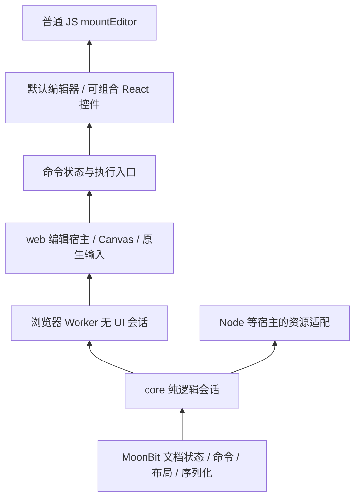

# G4 Office SDK 集成、UI 组件与交互交付

状态 `implemented`。2026-11-11 对照 Univer、GenOffice 和 BetterOffice，梳理并补齐无 UI SDK、编辑组件和主要交互的集成缺口。交付与验收见第 7 节。

产品目标与核心职责归 [SDK 合同](../references/sdk.md)，功能覆盖归 [G3](../g3-genoffice-sdk-gap.md) 和[格式合同](../references/formats.md)，阶段状态归[路线图](../references/roadmap.md)。本文拥有开发者体验、组件边界、交互差距和本轮截图依据。

## 1. 结论

四格式已提供纯逻辑会话、无 UI Worker 和可组合的 React 编辑器。普通 JS 使用同一挂载与保存生命周期。默认界面按任务组织常用操作。

调研时，默认 UI 已接通许多能力。DOCX 和 PPTX 的大量操作集中在横向滚动工具栏，侧栏同时展示多个任务，XLSX 的工作表管理占据编辑区域。第 7 节记录实施进度。

三者各有明确的参考价值：

| 参考 | 主要学习内容 | 本项目如何采用 |
| --- | --- | --- |
| Univer | 面向开发者的 Facade、能力组织、成熟表格交互、可替换 UI 区域 | 用简洁的领域 API 和有限组件插槽组织现有能力；表格控件按任务组织 |
| GenOffice | Office 功能区、上下文标签、图形化选择器、编辑工作区 | 作为默认 UI 和操作流程目标；继续由本项目核心执行命令 |
| BetterOffice | 原生文件字节接入、React 编辑器、可组合工具栏、命令状态和溢出菜单 | 作为 SDK 接入和组件合同的直接参考；保留当前 MoonBit 技术路线 |

目标交付应同时包含三种入口：纯逻辑会话、浏览器无 UI 会话、带默认 UI 或自定义 UI 的编辑组件。它们共享一个文档状态和同一组领域命令。无 UI 运行不能要求创建隐藏编辑器。

当前核心独立性已有证据。[P16.1](../p16-cross-host-runtime.md)记录了 Node 与 moonrun 中的四格式含图闭环。本轮需要补齐的是可供普通开发者使用的入口、资源配置和示例。不能把已通过的内部探针等同于已发布的跨宿主 SDK。

## 2. 证据范围

### 版本与方法

| 对象 | 固定依据 | 本轮实际运行 |
| --- | --- | --- |
| Open Document | `0046bca30df9b4a29a876c995b712b1d60775c85`；本轮开始时工作树干净 | Chrome 157.0.8103.40，macOS；本地开发预览加载当前 TS 与已有 Wasm 构建；打开四格式 |
| Univer | 本地源码 `d61608dace76b0db299c552eb3d1dccf0f8986dc`；在线官方文档 v1.4.0 | 官方 Sheets playground；在线部署 commit 未公开核实 |
| GenOffice | 本地源码 `5eab98adc8d0ebf6ecea687e42400a791ef58d64` | 本机 App 0.12.852 的 DOCX；仅作视觉和交互参考，未在 Chrome 运行它 |
| BetterOffice | 本地源码 `62605af397a309cb81c86aed8b8453a54a4edf22`；当日官方文档 | 官方 DOCX、PPTX demo；在线部署 commit 未公开核实 |

“实测”表示本轮操作并观察到的结果。“源码”表示已阅读实现或测试。“历史证据”表示已有报告，本轮没有重跑。“建议”表示待实施的设计。

在线 demo 只使用其自带内容。Open Document 使用本地空白 DOCX、XLSX/PPTX 参考样本和简单 PDF。没有把本地文档上传到外部 demo。不同产品的截图输入不同，只比较界面与操作，不比较排版保真或性能。

调研阶段使用已有 Wasm 构建。实施阶段重新构建并执行定向检查。源码、在线文档、部署 demo 和本机 App 的版本分别记录，不能相互替代。

### 已执行的交互

| 产品 | 操作 | 观察结果与范围 |
| --- | --- | --- |
| Open Document DOCX | 输入文字；新建文档；处理未保存提示；选中文字、加粗、撤销 | 输入可见；新建前有保留修改提示；格式状态变化，撤销后文字保留。没有执行保存下载或重开 |
| Open Document XLSX/PPTX/PDF | 打开样本，检查编辑区、导航、属性入口 | 四类界面均出现文档内容。只证明本轮输入可显示，不代表所有菜单已验收 |
| Open Document DOCX/XLSX | 在 960×720 视口查看界面 | DOCX 工具栏横向滚动；XLSX 底部管理表单明显压缩网格高度 |
| Univer Sheets | 选中 B5:D8，打开边框菜单；切换加粗后撤销 | 出现图形化边框选项；撤销恢复原加粗状态 |
| BetterOffice DOCX | 插入菜单选择 2×2 表格，再撤销 | 表格插入后撤销可用；撤销移除新表格，重做可用 |
| BetterOffice DOCX | 960×720，打开 More actions | 工具组移入菜单，仍可访问对齐、列表等操作 |
| BetterOffice PPTX | 查看缩略图和备注；切换 Read-only | 编辑工具隐藏，备注输入禁用。未验证程序化写入限制 |
| GenOffice DOCX | 新建空白文档；切换 Insert；打开 Table | 出现按任务分组的功能区和表格网格选择器；未执行插入 |

## 3. 产品与架构对照

### 3.1 Headless 必须区分三种含义

| 模式 | 应具备的能力 | 不应隐含的依赖 |
| --- | --- | --- |
| 纯逻辑 | 打开字节、查询、编辑、计算、排版、保存，以及已支持的核心输出 | DOM、Canvas、React、Electron、网络转换服务 |
| 浏览器无 UI | Worker 中运行上述逻辑，向页面返回类型明确的结果 | 隐藏 DOM 编辑器、挂载工具栏、浏览器排版 |
| 无工具栏的交互视图 | 保留 Canvas、输入法、选区、键盘、无障碍；宿主自己画 UI | 不应称为纯逻辑会话；它仍需要浏览器视图 |

截图或浏览器打印也不能直接证明核心输出可移植。布局数据、PDF 字节、位图输出要分别声明运行条件。

### 3.2 各产品的边界

| 维度 | Univer | GenOffice | BetterOffice | Open Document 当前 |
| --- | --- | --- | --- | --- |
| 主要交付 | Web SDK、Facade、预设和插件 | 桌面 Office 应用及其引擎代码 | 分格式无框架核心、React 编辑器、其他语言入口 | 四格式 `core/web/react/worker`、默认 UI、普通 JS 示例 |
| 无 UI | JS/TS 内容模型和已注册能力；可在 Node 或浏览器运行 | DOCX headless 导出使用隐藏 Electron renderer | Rust 核心、Wasm 与原生绑定；具体入口各有边界 | 纯核心会话和 Worker 客户端；P16.1 已有无 DOM 证据 |
| 文件边界 | 当前官方 Office 导入导出指南使用独立 Server SDK；snapshot 保存不等于 Office 文件保存 | 应用负责本地文件与转换流程 | React 编辑器直接接收文件字节；字体另行配置 | 原生格式字节与输出已接通；资源配置较底层 |
| UI 组合 | Facade 菜单、组件与 UI 区域注册 | 丰富应用 UI；耦合各编辑引擎及应用状态 | 公开 React 编辑器；DOCX 工具栏组件和命令 store | 主 `react` 入口是 `mountEditor`；内部组件依赖内部 controller |
| 格式范围 | 当前文档已有 Sheets、Docs、Slides、PDFs 等；各能力及授权分别核实 | 四格式功能目标 | 本轮文档与 demo 核对 DOCX/XLSX/PPTX；不能把 PDF 导出当作 PDF 编辑器 | DOCX/XLSX/PPTX/PDF 均有领域包与默认 UI |

Univer 官方明确区分 Headless Univer 和 `univer-rs` 服务端计算/转换。Headless 只具有已注册插件的能力，部分看似无 UI 的插件仍依赖 UI 服务。不能从包名推断可移植性。[Headless 指南](https://docs.univer.ai/overview/features/shared/server-calculation)

Univer 的当前导入导出文档以 `@univerjs-pro/exchange-node` 转换 Office 字节与 snapshot。这里描述的是已核实的官方路径，未证明其所有产品都没有其他路径，也没有证明在线 demo 在浏览器本地完成转换。[导入导出指南](https://docs.univer.ai/server/import-export)

BetterOffice 与本项目的原生格式路线更接近，但 Rust 原生绑定、Wasm 和各语言接口不能直接等同于“一份二进制在所有宿主运行”。其 `xlsx/headless` 文件主要暴露无 DOM 的视口、选择和绘制数据工具，单看这个入口不足以证明完整 XLSX 读写闭环。[项目说明][b-readme]、[headless 源码][b-headless]

### 3.3 应借鉴的 SDK 设计

**Univer：简单入口与深入控制并存。** Facade 为复杂服务提供面向开发者的 API。菜单和 UI 区域可以注册并释放，宿主不必修改内部组件。借鉴这层稳定边界即可；当前项目没有建设通用依赖注入或插件微内核的必要。[Facade 文档](https://docs.univer.ai/guides/sheets/getting-started/facade)、[固定版本 UI Facade][u-facade]

**BetterOffice：编辑器和控件都能单独使用。** React 编辑器提供字节输入和保存回调。DOCX 的默认工具栏可替换、关闭，或通过 command provider 放到编辑器外部。默认 UI 和宿主 UI 共享命令的 active、mixed、disabledReason 状态；菜单操作与快捷键使用同一命令。[JavaScript 指南](https://docs.betteroffice.dev/docs/javascript)、[公开导出][b-exports]

BetterOffice 的源码测试还覆盖：队列前序输入完成后再执行命令、文档替换后拒绝旧目标、双编辑器隔离、工具栏溢出后的键盘导航和焦点恢复。这些是组件合同的重要部分。源码存在这些用例，不代表本轮执行过其测试。[命令测试][b-command-tests]、[宿主工具栏测试][b-host-tests]、[溢出菜单测试][b-overflow-tests]

**GenOffice：围绕任务组织默认界面。** DOCX 的常规功能区与表格上下文标签分开。它适合回答“当前选区应该显示什么工具”。源码中 Tiptap 命令、Electron 文件流程和 Sheets 的 Univer 集成需要识别，不能连同 UI 一并迁入。[DOCX Ribbon][g-ribbon]、[Sheets 依赖][g-sheets]、[headless 导出][g-headless]

## 4. 当前仓库已有的基础

以下是源码事实。它们决定实施可以直接改动现有层，而无需重新搭建 SDK。

| 已有基础 | 入口 | 对本轮实施的意义 |
| --- | --- | --- |
| 分格式公开入口 | [DOCX package](../../packages/docx/package.json)；其他格式结构相同 | 保留分格式按需引用；明确稳定导出，收紧通配内部路径 |
| Wasm 编译复用与 ABI 检查 | [loader](../../packages/wasm/src/loader.ts) | 扩展可接受的资源来源，继续复用缓存和版本校验 |
| 纯逻辑会话与类型命令 | [DOCX core](../../packages/docx/src/core/index.ts)、[FoundationSession](../../packages/docx/src/core/foundation.ts) | 保留领域语义；为常用操作整理易发现的入口 |
| Worker 无 UI 客户端 | [DOCX FoundationClient](../../packages/docx/src/web/foundation.ts) | 将其作为独立交付检查，审计整个依赖链而非只看类名 |
| 编辑快照和保存凭据 | [editor-state](../../packages/web-core/src/editor-state.ts) | 保留 documentId/revision、不可变快照和保存结果归属校验 |
| 默认挂载与释放 | [UI mountProduct](../../packages/ui/src/index.ts)、[DOCX mountEditor](../../packages/docx/src/react/index.tsx) | 提炼共同生命周期，让 React 和命令式挂载使用同一路径 |
| 文件菜单、对话框与稳定原生节点 | [controls](../../packages/ui/src/controls.tsx) | 继续使用 Base UI 与 NativeSlot，保留焦点、IME 和保存保护 |
| Shadow DOM、主题与语言 | [UI 类型](../../packages/ui/src/types.ts)、[样式](../../packages/ui/src/styles/ui.css) | 把已有机制整理为可定制合同，避免要求宿主穿透内部 DOM |
| 普通 JS 宿主示例 | [web-sdk 示例](../../examples/web-sdk/app.js) | 继续验证真实宿主保存；补无 UI 和 React 接入路径 |

`react` 主入口当前返回命令式 `mountEditor`，不等于已交付可直接渲染的 `<DocxEditor />`。内部 `Product.render` 已有插槽，但参数包含 `EditorController`、`OwnedFile` 等内部所有权对象，不能直接当作稳定的外部组件协议。

包目前为 `private: true`，并暴露多组 `./core/*`、`./web/*`、`./react/*` 通配路径。源码能导入与外部项目能使用发布产物是两件事。需要先做本地打包消费检查，发布另按授权执行。

## 5. UI 与交互差距

### 5.1 共同差距

| 优先级 | 观察与依据 | 用户影响 | 建议结果 |
| --- | --- | --- | --- |
| P0 | DOCX 在 960px 下，编辑工具栏 `clientWidth=960`、`scrollWidth=2907`；PPTX 在 1808px 下为 `1808/9655`；CSS 明确使用横向滚动 | 常用操作进入屏幕外，功能难发现 | 按任务分页和分组；窄宽度按整组移入 More 菜单 |
| P0 | DOCX 右侧面板在所测状态下可视高度 496px、内容高度 13270px | 属性、审阅、插入和设置混在一条长表单中 | 根据当前任务和选区打开面板；无关内容按需显示 |
| P0 | `CommonOptions` 没有公开 toolbar、sidebar、mode 等组合合同 | 宿主要修改内部 UI 才能改变编辑体验 | 提供完整编辑器、仅视图、可组合控件三种用法 |
| P0 | UI `Command` 主要接收 label/action/disabled；禁用逻辑分布在面板 | 自定义工具栏难以同步选区、混合格式和禁用原因 | 一份命令状态同时服务按钮、菜单和快捷键 |
| P0 | 对 `packages` 的检索未发现 `contextmenu/onContextMenu/ContextMenu` 编辑菜单实现 | 表格、对象、工作表等局部操作缺少就近入口 | 用同一命令增加上下文菜单，支持键盘打开 |
| P0 | 现有文件菜单、未保存保护、快照、输入宿主已存在 | UI 重组可能破坏已有可靠行为 | 新 UI 复用现有生命周期与保存状态，不另建状态副本 |
| P1 | 默认界面大量原生下拉框和数值表单；主题、语言选择长期占据标题栏 | 频繁操作需要理解参数，工作区密度低 | 常用操作使用图形化控件；低频全局设置归入菜单 |

以上尺寸是本轮特定文档与视口的 DOM 测量，不是所有状态的固定值。横向滚动仍能访问工具，问题是交互效率与可发现性，不能写成命令不存在。

当前 DOCX 窄窗口：

BetterOffice 同宽窗口，More actions 已展开：

### 5.2 DOCX

现有 `docx-format` 和属性面板已经连接大量格式、表格、引用、审阅和页面操作。本轮实际加粗与撤销成功。缺口主要是呈现顺序、上下文和参数选择方式。[现有格式面板](../../packages/docx/src/react/docx-format.tsx)

| 用户任务 | 当前差距 | 建议 UI 与完成条件 |
| --- | --- | --- |
| 日常文字编辑 | 常用格式与插入等命令横向并列 | 默认显示字体、字号、常用格式、段落和样式；隐藏低频组后常用操作仍可达 |
| 插入表格 | 已有创建能力，但缺少紧凑的二维选择体验 | 网格选择器支持指针预览、行列键盘输入；确认只产生一次历史记录 |
| 修改表格/图片 | 需要在长面板中寻找属性 | 选中对象时出现上下文工具和对应属性面板；关闭面板后恢复编辑焦点 |
| 选择颜色、边框、样式 | 参数输入偏多，缺少效果预览 | 调色板、边框图示、样式预览共用核心状态；保留主题色和继承语义 |
| 批注、修订、引用 | 多类任务同时挤在属性区 | 独立审阅与引用入口；条目选择能定位文档，文档选择同步条目 |
| 设置页面 | 设置项与正文格式混排 | Layout 中使用有单位的尺寸控件、方向和边距预设，更多设置放对话框 |

建议常规标签：Home、Insert、Layout、References、Review、View；选中表格、图片或页眉页脚时增加对应上下文标签。标签只包含已支持能力，具体名称按中英文词表统一。不要为了对齐截图增加未实现菜单。

GenOffice 的 Home 功能区与表格选择器提供视觉参考：

[GenOffice 表格选择器](../assets/g4-office-sdk/genoffice-table-picker.png)与 [BetterOffice 表格选择器](../assets/g4-office-sdk/betteroffice-table-picker.jpg)均采用网格。BetterOffice 此次可读取到逐格的行列标签；GenOffice 此次原生 AX 中出现多个无名称按钮。借鉴外观时仍需自行实现可访问名称，不能据此认为上游控件已满足本项目无障碍要求。

### 5.3 XLSX

调研时，UI 右侧集中表格、排序、筛选、透视和格式，底部集中工作表和行列管理。公式栏已有原生输入、地址定位和计算状态。实施后，Home 提供数字格式示例和边框预设，行列标题提供结构和尺寸菜单，公式栏复用核心函数目录提供补全。[格式面板](../../packages/xlsx/src/react/panels.tsx)、[公式栏](../../packages/xlsx/src/react/xlsx-formula.tsx)、[工作表控件](../../packages/xlsx/src/react/xlsx-sheets.tsx)

| 用户任务 | 建议调整 |
| --- | --- |
| 修改字体、数字格式、对齐、边框 | 放入 Home 常用工具组；数字格式展示效果预览，边框提供图示 |
| 切换/新增工作表 | 底部保留紧凑标签和新增按钮；重命名、复制、隐藏、删除、移动放标签菜单或管理弹层 |
| 插入/删除行列、调整尺寸 | 从底部常驻表单移到行列标题菜单；保留明确的作用范围 |
| 排序、筛选、验证和透视 | Data 标签给任务入口；仅打开当前任务面板；条件修改可取消 |
| 输入公式 | 地址栏、公式栏保持可编辑；提供函数名称、参数提示和引用高亮；候选只反映已支持语义 |
| 查看状态 | 工作表标签、选区统计和缩放构成紧凑底栏；诊断详情按需展开 |

Univer 的可借鉴点是表格任务的空间分配：工具栏、地址/公式栏、网格、工作表标签各司其职；边框菜单直接表达结果。它的依赖体系和文档模型无需引入本项目。

### 5.4 PPTX

`PptxSlideList` 当前主要显示编号和标题按钮，前方还有导入与放映设置。顶部集中许多对象、结构和动画管理操作。已有对象选择和变换能力不需要重做；需要让用户从画面完成常用动作。[幻灯片导航](../../packages/pptx/src/react/pptx-slides.tsx)、[格式面板](../../packages/pptx/src/react/panels.tsx)

| 用户任务 | 建议调整 |
| --- | --- |
| 选择、复制和重排页面 | 左侧以真实缩略图为主；页面菜单提供复制、删除、隐藏，重排提供拖动和键盘方式 |
| 插入页面与选版式 | 使用可预览的版式画廊；导入入口回到文件或插入菜单 |
| 编辑形状、文本、图片 | 选择对应对象时显示上下文工具；右侧只展示相关属性 |
| 对齐、分布、层次和组合 | 用可视图标与选择状态表达作用；精确坐标保留在属性面板 |
| 备注和放映 | 备注放工作区下方，可收起；放映入口固定，设置按需打开 |
| 动画与切换 | 独立标签和面板，默认页面编辑不被全部参数占据 |

缩略图应复用已有绘制结果和资源，不引入第二套渲染器。只渲染可见及附近页面，按文档、页标识和 revision 失效；必须正确释放位图。

[当前 PPTX 截图](../assets/g4-office-sdk/open-document-pptx.jpg)展示相同区域目前的安排。两张图使用不同文档，不作文本或形状保真对比。

### 5.5 PDF

PDF 已有阅读、视图、页面、批注标签，也有缩略图组件和有界挂载逻辑，不应重新登记为“没有缩略图”。当前阅读标签仍放置插入文字、图片、水印等修改操作；右侧将字段、内容对象和元数据放入同一选择框。[缩略图实现](../../packages/pdf/src/react/thumbnail.tsx)、[当前界面](../assets/g4-office-sdk/open-document-pdf.jpg)

建议按阅读、编辑内容、批注、页面整理、表单分组。元数据放文件属性；搜索结果提供定位；字段属性只在选中字段时出现。页面整理支持清楚的多选和撤销。

真实脱敏继续使用现有独立清理输出，UI 明确区分标记、预览和应用。普通遮盖、删除或裁剪不能呈现为完成脱敏。已有签名和保护状态的限制继续展示原因。不要用 UI 重组扩大 PDF 编辑或转换承诺。

## 6. 建议的 SDK 交付边界

### 6.1 保留现有层次，整理公开合同

下图是建议的职责关系，不表示新增同名 package：

| 入口 | 应交付的开发者合同 | 当前需要补齐的部分 |
| --- | --- | --- |
| `core` | 从字节或预编译模块创建运行时；打开/新建领域会话；显式操作、输出和释放 | 稳定的入口与命名、资源注入、公开支持面；避免依赖内部 `/engine` 路径 |
| 浏览器无 UI | 创建 Worker 会话，异步查询/编辑/保存；支持取消和错误阶段 | 明确无 DOM 的导出路径；检查导入依赖、字体和图片路径；无需 `HTMLElement` |
| `web` 交互宿主 | 稳定编辑表面、输入、选择、状态订阅和输出；无 React 要求 | 与无 UI 会话区分；公开可用的命令状态和模式合同 |
| `react` | 真正的四格式 React 编辑器；默认 UI、仅视图、公开工具栏与面板组件 | 从内部挂载生命周期提取共同实现；React 卸载与重挂载正确释放资源 |
| 命令式挂载 | 普通 JS 中 `mountEditor(container, options)`，返回可释放实例 | 与 React 路径共享实现；保持已有保存保护和候选打开流程 |

不建议增加一套把所有格式方法扁平化的巨大 `Office` API。文档生命周期、资源和状态保持一致；段落、单元格、幻灯片、PDF 对象使用各自领域类型。底层 typed commands 可保留为进阶接口，常用操作避免让宿主手写内部协议。

纯逻辑验收应沿实际依赖链检查。例：DOCX `FoundationClient.execute` 在粘贴 HTML、Markdown 或片段时，会调用[图片准备路径](../../packages/docx/src/web/document-fragment-images.ts)。该路径优先使用核心返回的 RGBA，其他情况仍调用平台 `materializeImage`。整理无 UI 入口时，应明确哪些输入完全由核心处理，哪些需要显式宿主适配；不能只验证普通文字后就承诺全部命令无浏览器依赖。图像内容解析与可移植解码继续归核心，资源获取和平台位图释放留在宿主。

### 6.2 资源加载是即插即用的一部分

当前 `resources` 要求宿主传入 engine、workerUrl、字体字节和 profile。它足够显式，但初次接入需要理解过多内部细节。建议提供一种推荐配置，并保留原有显式控制能力。

1. 构建产物提供关联 Wasm、Worker 和构建身份的资源清单。
2. 默认示例从同源静态目录加载资源。
3. Loader 接受 URL，也提供字节或预编译 Module 路径。
4. 字体使用具名资源包与清楚的替代规则。
5. 资源加载失败返回可定位的阶段、资源和原因。
6. 外部项目使用打包产物验证四格式按需加载。

清单不能自动引入远程字体、遥测或转换服务。若宿主选择 CDN，来源由宿主明确配置。打包示例说明 MIME、CSP、Worker URL、资源路径与离线缓存要求。纯逻辑入口导入时不能触发浏览器资源获取。

WasmGC、JS string builtins、宿主的编译选项和字体输入仍是运行条件。Node 支持应指向已验证版本；其他运行时继续按 P16 验证，不泛称“任意 WASM runtime 可运行”。

### 6.3 一份命令状态服务所有 UI

这里的命令层是现有领域命令与 UI 之间的薄适配，不是第二个文档模型。

| 状态/行为 | 所属层 | 约束 |
| --- | --- | --- |
| 当前选择、格式值、mixed、文档保护、操作适用性 | MoonBit 领域核心 | UI 不自行推断文档语义；复用已有查询，按缺口补齐 |
| busy、输入组合、打开/关闭、宿主编辑模式 | Web 会话与编辑队列 | 排队后再次核对文档身份、目标与可执行状态 |
| 标签、图标、快捷键文本、分组、菜单位置 | UI 命令描述 | 默认工具栏、上下文菜单和宿主控件读取同一描述与状态 |
| 文档变化与历史 | 现有领域命令 | 一次用户动作形成定义明确的事务；失败不残留部分修改 |
| 宿主保存与下载 | 现有输出与保存合同 | 下载和宿主持久化分别记录；旧 revision 的回执不清除新修改 |

公开命令状态至少表达 available/enabled、active/mixed、当前值和禁用原因；具体字段名在实现时统一。已有 format/protection 查询应直接复用。UI 不应重复读取整份文档来计算每个按钮。

默认按钮、自定义按钮、快捷键和菜单都经同一执行入口。打开对话框时记录文档和目标；确认时检查目标仍有效。异步打开新文档后，旧对话框不能把修改写到新文件。

公开 `view/edit` 模式是 P0 组件合同。只读时保留选择、搜索和允许的输出，同时拒绝该编辑实例的修改入口。批注或修订模式按已支持语义扩展。模式限制不等于访问控制安全边界；持有原始字节或独立核心会话的宿主仍能另行修改文档。

### 6.4 组件合同

先覆盖实际集成需求：完整编辑器、隐藏默认工具栏、替换工具栏、放置宿主操作、切换属性面板。内部 `Product.render` 可以重构为有限公开插槽，不直接暴露 `OwnedFile` 所有权。

| 组件能力 | 建议合同 |
| --- | --- |
| 完整编辑器 | 文档来源、资源、主题、语言、模式、保存回调、状态/错误通知、实例引用 |
| 文件替换 | 首次文档与后续 `open` 语义明确；不把 React 每次 render 当作重新打开 |
| 工具栏 | 默认、关闭、自定义三种状态；宿主可复用格式按钮、下拉框和工具组 |
| 外置控件 | 通过明确的实例/provider 订阅命令；双编辑器不共享活动选区 |
| 工作区 | Canvas、原生输入与无障碍节点保持稳定；面板变化不重挂载输入 |
| 插槽 | 工具栏、导航、属性、状态栏和宿主操作；每个插槽有范围明确的状态与动作 |
| 主题 | 公共 CSS tokens、字体尺寸与密度；文档缩放独立于 UI 尺寸 |
| 弹层 | 菜单、对话框在实例 portal 内；焦点返回触发控件或编辑表面 |
| 无障碍 | 清楚的控件名称、mixed/pressed/disabled、键盘菜单、焦点可见、状态通知 |

React 入口应在导入时不访问 DOM，允许宿主在服务端加载模块并在客户端挂载。仅对实际示例验证，不同时增加所有框架封装。保留现有 React、Base UI、Tailwind 和 Shadow DOM；无需新增组件库。

React 组件直接管理自己的组件树；命令式 `mountEditor` 创建 root 并挂载同一组件。不要让 React 包装组件再次调用内部 `createRoot`。会话、Worker 和表面的创建与释放提炼为共同生命周期，字体及已编译引擎继续按现有资源所有权复用。React 重渲染只更新界面配置，不隐式替换文档。

优先做可复用的字体/字号选择、颜色面板、边框面板、有单位的数值输入、表格网格选择器、溢出菜单、属性面板和上下文菜单。控件只负责交互；格式继承、取值范围、选择语义与预览布局归核心。

## 7. 交付结果与验证

2026-11-11：四格式已提供独立 `headless` 入口。Loader 接受字节与 Module，并可按格式加载同源资产。用本地打包产物在 Chrome Worker 中编辑、保存并重新打开四个含图样本。DOCX、XLSX 和 PPTX 的嵌入图片字节保持一致。Node 的独立打包消费示例验证了 DOCX 文件读写。入口和示例见[开发说明](../references/development.md#无-ui-示例与静态资源)。

四格式提供 React 组件并共享命令式挂载流程。Chrome 已验证 DOCX 外置加粗、混合格式、工具栏切换与保存重开。定向用例覆盖双实例、保存回执、四格式查看模式和文档替换后的旧目标。共用文字命令在编辑队列中复核目标，XLSX 用例验证排队切换选区后拒绝旧加粗操作。实际接口见 [React integration](../references/development.md#react-integration)。查看模式的任务入口和四格式默认界面继续按下表组织。

DOCX 默认界面已按 Home、Insert、Layout、References、Review 和 View 组织。选中表格、图片或页眉页脚时显示对应工具。960px 下的 More 菜单保留低频命令，图片、批注和页面设置各有独立入口。调色与插表在执行时核对弹层打开时的选区。真实 Chrome 已人工检查窄屏菜单、插表网格、调色板和 1280px 的页边距预设。定向 Chromium 用例验证中文输入、键盘焦点、表格保存重开、图片裁剪与取消拖动、批注及页面设置。

在 1280×800 的真实 Chrome 中，用打包后的 React 示例提交中文输入、设置粗体和颜色、用键盘插入 2×2 表格，并撤销和重做。下载的 DOCX 含原输入、颜色及四个单元格。重新打开下载文件后人工核对正文和表格显示。

XLSX 已将常用文字格式、对齐、数字格式和边框放进 Home。数字格式示例由 MoonBit 生成。边框菜单显示六个预设的图示，编辑队列核对打开菜单时的选区。底栏保留工作表标签与新增按钮，管理表单按需打开。单行和单列操作从标题菜单进入，批量尺寸从 Layout 进入，筛选、排序和透视表从 Data 进入。真实 Chrome 在 960px 下人工查看了网格、工作表管理、行列菜单和边框预设，并操作了设置行高、应用边框和撤销。定向 Chromium 用例核对标题目标、公式引用迁移、格式样例、字节级撤销和排队切换选区后的边框拒绝。入口和作用范围见 [XLSX 编辑合同](../references/formats/xlsx-editing.md)与 [XLSX 显示与计算](../references/formats/xlsx-calculation.md#显示与计算)。

XLSX 公式栏和格内输入已接入 MoonBit 函数补全、嵌套参数提示和 A1 引用高亮。Chrome 在 960px 下人工查看了候选、活动参数和网格引用边框，并用键盘接收 `SUM` 后提交公式，得到计算结果 `7`。四条定向 Chromium 用例覆盖 Worker 查询、原生撤销、保护与验证、保存重开。API 和引用范围见 [XLSX 显示与计算](../references/formats/xlsx-calculation.md#显示与计算)。

PPTX 已按任务组织功能区。左侧缩略图支持逐页操作、拖动和 Alt 加方向键重排，右侧按需显示版式和对象工具，备注在画布下方。缩略图复用 MoonBit 绘制命令和 Canvas 渲染，目标页的图像缓存独立于当前编辑页。真实 Chrome 已人工查看 960px 的画布、逐页菜单和备注，以及 1280px 的版式图库。四条定向 Chromium 用例覆盖含图预览、重排、版式、备注、分节与保存重开。

PDF 默认界面将阅读、内容、批注、页面和表单分开。搜索结果可直接定位并高亮命中。元数据从文件属性进入。页面任务支持多选、批量移动、旋转、提取和移除。真实 Chrome 已人工查看 960px 的搜索、页面多选和脱敏预览，操作了表单输入、批量旋转和撤销。定向 Chromium 用例通过搜索定位、文字高亮、表单与元数据编辑、保存重开、批量移动与旋转的独立撤销、选页提取和脱敏副本导出。用 Poppler 核对脱敏副本保留的文字，源文件字节保持一致。保护边界和接口见 [PDF 格式合同](../references/formats/pdf.md#web-嵌入与生命周期)。

静态部署的普通 JS、React 和 Worker 示例共用可分发 DOCX 样本。真实 Chrome 在 960×720 下使用强制 CSP 打开三个页面，人工核对默认工具栏弹层、自定义工具栏和 Worker 下载入口。React 宿主加粗与工具栏同步，切换仅查看后两处都禁用，关闭后可重新挂载。定向用例模拟 Wasm、字体和 Worker 加载失败，验证可定位错误和恢复。独立消费目录从七个包的归档解析公开入口，在 Chrome 按需打开四个格式，每次只请求对应的 Wasm 和 Worker。Node 26 用打包的 DOCX 核心写入前缀。部署配置见 [CSP 与资源错误](../references/development.md#csp-与资源错误)。

四格式共用的设置菜单已收纳主题和语言，标题栏和文件菜单使用同一保存命令。PPTX 对象工具的四个文字格式按钮与属性面板、宿主控件和快捷键共用核心格式状态。真实 Chrome 在 960×720 下人工核对深色中文设置、PPTX 混合加粗和选区格式同步。定向用例覆盖 CSP 下键盘切换设置、输入节点保留、PPTX 命令同步、仅查看模式及字节级撤销。

四格式功能区的动作按钮使用同一尺寸的 Icon MCP 内联 SVG，并提供可访问名称。功能区与 More、上下文菜单共用动作图标。人工查看真实 Chrome 中的 DOCX 插入、XLSX 数据、PPTX 设计和 PDF 批注功能区。XLSX 在 960×720 下用图标按钮完成了选区跳转、字号确认和重算。

`EditorFontControls` 已接入 DOCX、XLSX 的 Home 和 PPTX 的 Object tools，并对宿主公开。字体列表使用当前选区和已映射的字体名称。字号确认沿各格式原有事务执行，选区变化后会清除待应用的字号。真实 Chrome 在 960×720 下人工核对三种格式的字体与字号变更，XLSX 的数字格式、边框与 More 菜单保持同排。定向用例核对 DOCX 混合选区、XLSX 草稿提交与撤销，以及 PPTX 文件字号精度与面板同步。[可复用控件](../references/development.md#react-integration)

`EditorPanel`、`EditorColorPalette` 和 `EditorTablePicker` 可从 UI 包根入口导入。弹层使用插槽提供的实例容器，选择色块和确认插表时把打开弹层时的目标交给原有编辑队列。真实 Chrome 在 960×720 下核对了自定义属性面板、调色板和关闭后回到正文。两条定向用例覆盖 CSP 下宿主调色、混合颜色、保存重开、键盘插表和焦点回归。[React integration](../references/development.md#react-integration)

宿主可通过 `--od-editor-*` 设置界面颜色、圆角、字号和控件密度。真实 Chrome 在 960×720 下核对了明暗主题的宿主强调色、字号和调色板。定向用例验证切换样式时保留原生输入节点、Canvas 尺寸和文档缩放。[React integration](../references/development.md#react-integration)

DOCX 样式选择器显示 MoonBit 解析的继承字形和主题色。表格边框菜单显示外边与内部横竖边的图示。真实 Chrome 在 960×720 下人工查看了标题预览和边框菜单，并应用标题样式、插入 2×2 表格、修改内部横边和撤销。两条定向 Chromium 用例核对继承与主题色、内部横边、原生文字编辑、字节级撤销与 PDF 输出。[样式目录](../references/formats/docx-editing.md) · [表格边框](../references/formats/docx-tables.md#表格边框)

DOCX 修订列表与正文共用 MoonBit 提供的定位范围。在 960×720 的真实 Chrome 中，点击列表中的删除修订会高亮正文并标记条目，随后点击同段的插入文字会切换当前条目，移到普通正文后清除标记。扩展原有修订导航用例，覆盖这两种方向、表格行修订、源文件及 PDF 字节一致性。[修订审阅](../references/formats/docx-content.md#docx-修订审阅)

DOCX 引用面板将标题与书签放在字段工具之前，并按正文选区标记当前条目。MoonBit 提供跨段书签的段落顺序及所属文字区域。真实 Chrome 在 960×720 下核对了点击正文后的标记切换、点击标题跨页和书签跳回。三条定向用例验证了段落拆分后的跨段范围、标题与书签定位、精确历史和重开。[书签与内部导航](../references/formats/docx-content.md#书签与内部导航) · [标题导航](../references/formats/docx-content.md#标题导航与正文统计)

PPTX 排列面板用带标签的图标展示六种对齐、两种分布和四种层级操作。常用层级命令排在旋转角度前。真实 Chrome 在 960×720 下人工查看面板，验证相对活动对象时禁用分布，切回相对幻灯片后可水平分布并撤销。既有组内操作用例核对层级、对齐、字节级撤销和保存重开。[PPTX 对象编辑](../references/formats/pptx-objects.md)

### 交付验收

| 判据 | 已核对范围 |
| --- | --- |
| 公开包可独立消费 | 在独立目录使用七个打包归档。Chrome 按需加载四格式，Node 26 运行 DOCX 核心示例。 |
| 核心和 Worker 可无 UI 运行 | 复用 P16.1 无浏览器全局对象的结果。新增入口在 Chrome Worker 对四格式含图样本完成编辑、保存和重开。 |
| 默认 UI 与宿主命令共享状态 | Chromium 核对混合格式、双实例、查看模式、过期目标、宿主保存回执和失败恢复。 |
| 960px 下常用任务可达 | 人工查看四格式的真实 Chrome 界面。用定向用例核对窄屏菜单、键盘导航及编辑输出。 |
| 原生输入、历史及输出保持一致 | DOCX 组合输入、XLSX 草稿和计算、PPTX 对象和页面、PDF 字段和页面都用受影响任务核对。保存重开及精确撤销按各格式条目记录。 |
| 公开 API 明确支持面 | [开发说明](../references/development.md)给出入口和资源配置。[格式合同](../references/formats.md)记录读取、显示、编辑、保真、保存和转换的边界。 |

范围为现有核心能力的 SDK 封装和本文列出的 UI 流程。兼容语料扩充归 [C1](../c1-corpus-and-producer-compatibility.md)，CLI 和其他宿主归 [P16](../p16-cross-host-runtime.md)。

## 8. 截图索引与复查路径

研究截图保存于 `docs/assets/g4-office-sdk/`，用于交互和视觉参考。上游产品的设计与标识归原项目。实施后的截图单独列出。

| 截图 | 入口/状态 |
| --- | --- |
| [Open Document DOCX](../assets/g4-office-sdk/open-document-docx.jpg) | 本地新建 `sdk-review.docx`，文字选中并加粗；DevTools 收起 |
| [Open Document DOCX 960](../assets/g4-office-sdk/open-document-docx-960.jpg) | 同一文档撤销加粗后，960×720 |
| [Open Document XLSX](../assets/g4-office-sdk/open-document-xlsx.jpg) | 本地 `sample.xlsx`，默认界面 |
| [Open Document XLSX 960](../assets/g4-office-sdk/open-document-xlsx-960.jpg) | 同一工作簿，960×720 |
| [Open Document PPTX](../assets/g4-office-sdk/open-document-pptx.jpg) | 本地 `testShapeAutofit.pptx`，默认界面 |
| [Open Document PDF](../assets/g4-office-sdk/open-document-pdf.jpg) | 本地 `basic.pdf`，阅读标签 |
| [Univer Sheets](../assets/g4-office-sdk/univer-sheets.jpg) | [边框与网格线 demo](https://office.univer.ai/playground/sheets/cell-borders-and-gridlines) |
| [Univer 边框菜单](../assets/g4-office-sdk/univer-border-menu.jpg) | 同一 demo，选择 B5:D8 后打开边框菜单 |
| [BetterOffice DOCX](../assets/g4-office-sdk/betteroffice-docx.jpg) | [DOCX demo](https://demo.betteroffice.dev/docx)，默认工具栏 |
| [BetterOffice 表格选择器](../assets/g4-office-sdk/betteroffice-table-picker.jpg) | Insert → Table |
| [BetterOffice DOCX 960](../assets/g4-office-sdk/betteroffice-docx-960.jpg) | 960×720，More actions 展开 |
| [BetterOffice PPTX](../assets/g4-office-sdk/betteroffice-pptx.jpg) | [PPTX demo](https://demo.betteroffice.dev/pptx)，切换只读之前 |
| [GenOffice DOCX](../assets/g4-office-sdk/genoffice-docx.png) | 本机 App 0.12.852，新建空白 DOCX，Home |
| [GenOffice 表格选择器](../assets/g4-office-sdk/genoffice-table-picker.png) | 同一文档，Insert → Table |
| [DOCX 实施后功能区](../assets/g4-office-sdk/sdk-docx-home-960.jpg) | 打包后的 React 示例，960×720，More actions 展开 |
| [DOCX 实施后插表](../assets/g4-office-sdk/sdk-docx-table-960.jpg) | 同一示例，键盘选中 2×2 |
| [DOCX 实施后页面设置](../assets/g4-office-sdk/sdk-docx-layout-1280.jpg) | 同一示例，1280×800，选中 36 pt 边距预设 |
| [DOCX 宽屏编辑](../assets/g4-office-sdk/sdk-docx-edit-1280.jpg) | 1280×800，图标更新前的流程，键盘选中 2×2 |
| [DOCX 宽屏保存重开](../assets/g4-office-sdk/sdk-docx-reopened-1280.jpg) | 更新后的 Insert 功能区，下载文件中的文字和四格表格可见 |
| [XLSX 实施后 Data](../assets/g4-office-sdk/sdk-xlsx-data-960.jpg) | 打包后的普通 JS 示例，960×720，网格和工作表标签可见 |
| [XLSX 实施后工作表管理](../assets/g4-office-sdk/sdk-xlsx-sheets-960.jpg) | 同一示例，管理面板打开 |
| [XLSX 行标题菜单](../assets/g4-office-sdk/sdk-xlsx-header-menu-960.jpg) | 同一示例，右击第 2 行，菜单显示操作目标 |
| [XLSX 数字格式与边框](../assets/g4-office-sdk/sdk-xlsx-borders-960.jpg) | 同一示例，选中 A2:B2，展开六个边框预设 |
| [XLSX 实施后函数候选](../assets/g4-office-sdk/sdk-xlsx-formula-candidates-960.jpg) | 同一示例，公式栏输入 `=su` |
| [XLSX 实施后公式引用](../assets/g4-office-sdk/sdk-xlsx-formula-references-960.jpg) | 同一示例，编辑嵌套 `IF`，标记 `A2:B2` 和 `A2` |
| [PPTX 实施后工作区](../assets/g4-office-sdk/sdk-pptx-workspace-960.jpg) | 打包后的普通 JS 示例，960×720，50% 缩放，含图幻灯片及备注 |
| [PPTX 实施后版式图库](../assets/g4-office-sdk/sdk-pptx-layout-1280.jpg) | 同一示例，1280×840，选中 Title and Content 预设 |
| [PDF 实施后搜索](../assets/g4-office-sdk/sdk-pdf-search-960.jpg) | 打包后的普通 JS 示例，960×720，双页样本定位到第二页 |
| [PDF 实施后页面整理](../assets/g4-office-sdk/sdk-pdf-pages-960.jpg) | 同一示例，选中两页 |
| [PDF 实施后脱敏确认](../assets/g4-office-sdk/sdk-pdf-redaction-960.jpg) | 960×720，合成样本的实际移除范围及导出确认 |
| [CSP 下的普通 JS 示例](../assets/g4-office-sdk/sdk-static-csp-960.jpg) | 同源加载样本后选择文档文字，展开 More actions |
| [CSP 下的 React 示例](../assets/g4-office-sdk/sdk-react-csp-960.jpg) | 宿主按钮和自定义工具栏显示同一加粗状态 |
| [React 自定义属性面板](../assets/g4-office-sdk/sdk-react-custom-panel-960.jpg) | 宿主复用调色板，文档选区保持可见 |
| [React 宿主主题](../assets/g4-office-sdk/sdk-react-theme-960.jpg) | 960×720，宿主调整强调色、字号和密度，展开调色板 |
| [CSP 下的 Worker 示例](../assets/g4-office-sdk/sdk-worker-csp-960.jpg) | 同源样本在 Worker 中修改后生成下载 |
| [共用设置菜单](../assets/g4-office-sdk/sdk-settings-960.jpg) | React 示例，深色和中文已选中 |
| [PPTX 共用文字命令](../assets/g4-office-sdk/sdk-pptx-text-commands-960.jpg) | 选中标题后，功能区与属性面板同步显示加粗 |
| [DOCX 字体与字号](../assets/g4-office-sdk/sdk-docx-font-controls-960.jpg) | Home 为所选正文应用 Liberation Sans 17.5 pt |
| [DOCX 样式预览](../assets/g4-office-sdk/sdk-docx-style-preview-960.jpg) | 样式面板预览 Heading 1 的字形和字号 |
| [DOCX 表格边框菜单](../assets/g4-office-sdk/sdk-docx-border-picker-960.jpg) | 新插入的 2×2 表格，打开整表边框图示 |
| [DOCX 修订导航](../assets/g4-office-sdk/sdk-docx-revisions-960.jpg) | 定位删除修订，正文高亮与列表标记同步 |
| [DOCX 引用导航](../assets/g4-office-sdk/sdk-docx-references-960.jpg) | 从第二页跳回书签，标记所在条目 |
| [XLSX 字体与字号](../assets/g4-office-sdk/sdk-xlsx-font-controls-960.jpg) | Home 为 A2 应用 18.5 pt，格式控件保持单行 |
| [XLSX 操作栏图标](../assets/g4-office-sdk/sdk-xlsx-action-icons-960.jpg) | 960×720，跳转至 A2:B2，确认 18.5 pt 并重算 |
| [PPTX 字体与字号](../assets/g4-office-sdk/sdk-pptx-font-controls-960.jpg) | Object tools 为所选标题应用 28 pt |
| [PPTX 对象排列](../assets/g4-office-sdk/sdk-pptx-arrange-960.jpg) | 选择两个形状，显示对齐、分布和层级操作 |
| [PPTX 设计图标](../assets/g4-office-sdk/sdk-pptx-ribbon-icons-960.jpg) | 960×720，版式、背景和设计动作 |
| [PDF 批注图标](../assets/g4-office-sdk/sdk-pdf-ribbon-icons-960.jpg) | 960×720，批注和脱敏副本入口 |

本地复查从仓库根目录执行 `bun run preview`，在 Chrome 打开 `http://127.0.0.1:4173`。该命令依赖已有 Wasm 构建；完整构建前提见[开发说明](../references/development.md)。输入样本继续由本地测试资源管理，公开消费示例应使用独立可分发的小样本。不要把研究页、协作房间标识或本机绝对路径写入 SDK 默认配置。

### 本轮限制与后续补证

没有对三家产品执行全格式保存重开、长文档性能或完整无障碍验收。没有实际运行其无 UI API；该部分依据官方文档和固定源码。Univer/BetterOffice 在线部署与本地源码可能不同，后续若借鉴具体实现，应在固定版本中补相应操作检查。

研究阶段沿用已有兼容性证据。第 7 节列出实施期间实际执行的消费端和交互检查。其他格式行为和兼容输入按相应格式合同验证。

## 9. 固定源码依据

- Univer：[UI Facade][u-facade]；在线资料的版本与源码快照分别见第 2 节。
- GenOffice：[DOCX Ribbon][g-ribbon]、[Sheets 依赖][g-sheets]、[DOCX headless 导出][g-headless]。更多功能入口归 [G3](../g3-genoffice-sdk-gap.md)。
- BetterOffice：[项目说明][b-readme]、[公开组件][b-exports]、[命令类型][b-commands]、[无 DOM 工具入口][b-headless]、[命令测试][b-command-tests]、[宿主工具栏测试][b-host-tests]、[溢出菜单测试][b-overflow-tests]。

[u-facade]: https://github.com/dream-num/univer/blob/d61608dace76b0db299c552eb3d1dccf0f8986dc/packages/ui/src/facade/f-univer.ts
[g-ribbon]: https://github.com/genspark-ai/genoffice/blob/5eab98adc8d0ebf6ecea687e42400a791ef58d64/apps/docs/src/renderer/components/Ribbon.tsx
[g-sheets]: https://github.com/genspark-ai/genoffice/blob/5eab98adc8d0ebf6ecea687e42400a791ef58d64/apps/sheets/package.json
[g-headless]: https://github.com/genspark-ai/genoffice/blob/5eab98adc8d0ebf6ecea687e42400a791ef58d64/apps/docs/src/renderer/headless-export.ts
[b-readme]: https://github.com/openooxml/betteroffice/blob/62605af397a309cb81c86aed8b8453a54a4edf22/README.md
[b-exports]: https://github.com/openooxml/betteroffice/blob/62605af397a309cb81c86aed8b8453a54a4edf22/packages/docx-react/src/index.ts
[b-commands]: https://github.com/openooxml/betteroffice/blob/62605af397a309cb81c86aed8b8453a54a4edf22/packages/docx-react/src/commands/types.ts
[b-headless]: https://github.com/openooxml/betteroffice/blob/62605af397a309cb81c86aed8b8453a54a4edf22/packages/xlsx/src/headless.ts
[b-command-tests]: https://github.com/openooxml/betteroffice/blob/62605af397a309cb81c86aed8b8453a54a4edf22/packages/docx-react/src/commands/createDocxCommandStore.test.ts
[b-host-tests]: https://github.com/openooxml/betteroffice/blob/62605af397a309cb81c86aed8b8453a54a4edf22/packages/docx-react/src/components/toolbar/HostToolbar.test.tsx
[b-overflow-tests]: https://github.com/openooxml/betteroffice/blob/62605af397a309cb81c86aed8b8453a54a4edf22/packages/docx-react/src/components/toolbar/ToolbarOverflow.test.tsx
