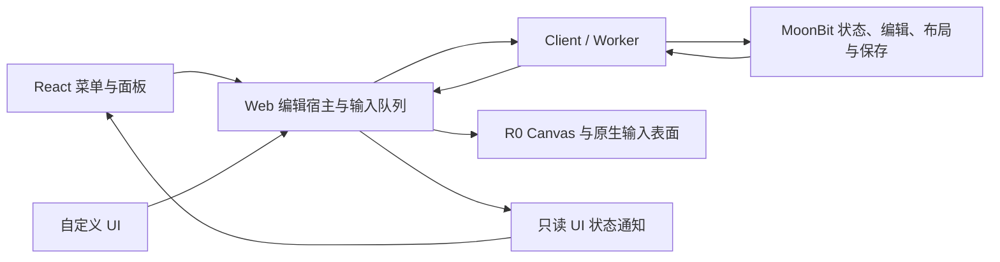

# P9 Web SDK 与默认 UI

状态：`planned`。本阶段属于功能优先级 P0，接在已完成的 P8 之后。本文件是待实施方案，下面的新包、接口和行为尚未交付。阶段顺序归[路线图](references/roadmap.md)，长期职责归 [SDK 合同](references/sdk.md)，当前 API 与支持范围归[格式合同](references/formats.md)。

## 1. 用户结果与范围

宿主用普通 JavaScript 挂载 DOCX、XLSX、PPTX 或 PDF 编辑器。用户通过 GenOffice 风格的默认 UI 打开文件、使用现有编辑能力、撤销、导航、缩放、保存和输出。宿主也能直接使用框架无关的 Web 编辑宿主构建自己的 UI。

默认 UI 采用 React + open Shadow DOM + Tailwind CSS + Base UI（`@base-ui/react`）。GenOffice 本地源码决定功能入口、外观与交互参考；Office 能力、布局和算法仍优先参考 ONLYOFFICE，其次 LibreOffice。

| P9 交付 | 范围 |
| --- | --- |
| 可嵌入入口 | 容器挂载、明确资源输入、同格式打开/替换文件、状态观察、保存回调和释放 |
| 默认 UI | Ribbon 分组、文件菜单、导航、已有属性操作、状态栏、错误与恢复提示 |
| 四类现有操作 | 见第 6 节；按钮、快捷键和程序化调用使用同一编辑宿主 |
| 样式与交互隔离 | 实例内样式、Portal、焦点、快捷键和稳定的原生输入节点 |
| 接入产物 | 可本地安装的包、类型、构建好的 UI 样式、最小普通 JS 宿主示例 |

新建文档、DOCX 格式/结构编辑、XLSX 新公式/数据操作、PPTX 对象创作/放映、PDF 正文编辑分别归 P10–P13。缺少核心支持的控件不显示为空按钮。缩略图没有可安全复用的读取路径时，本阶段使用真实页码/标题列表，不为复刻缩略图新增布局引擎。连续多页视图、性能专项、AI、协作、Diff 和跨宿主沿后续阶段推进。

P9 完成只授予“现有能力可通过 SDK 和默认 UI 使用”，不授予完整 GenOffice 功能。功能差距继续由 [G3](g3-genoffice-sdk-gap.md)维护。

## 2. 已有实现与需要改动的位置

| 当前入口 | 现状 | P9 改动 |
| --- | --- | --- |
| [`DocumentEditor`](../packages/web/src/editor.ts) | 工具栏、状态、Canvas、IME 与输入队列在一个类中；历史和翻页入口部分为私有方法 | 移出展示控件；公开已有操作与只读 UI 状态；保留选区、组合和恢复流程 |
| [`SpreadsheetEditor`](../packages/web/src/spreadsheet-editor.ts) | 已有工作表/缩放控件、单元格原生草稿、输入队列与打印视图；释放是同步方法 | 移出控件；保留草稿提交顺序；提供可等待的关闭与状态通知 |
| [`PresentationEditor`](../packages/web/src/presentation-editor.ts) | 已有页/对象选择、文本和拖动候选、历史与恢复 | 移出工具栏；保持候选事务；调整[对象列表焦点恢复](../packages/web/src/presentation-semantics.ts)对 Shadow DOM 的处理 |
| [`PdfViewer`](../packages/web/src/pdf-viewer.ts) / [`PdfEditor`](../packages/web/src/pdf-editor.ts) | Viewer 自建 client；Editor 继承阅读、搜索、队列和原生属性草稿；close/dispose 语义不同 | 分离连接创建、展示控件与编辑表面；公开已有批注/字段操作，保留草稿保护与搜索取消 |
| [`Connection`](../packages/web/src/connection.ts) | 每个连接只允许一个在途请求 | 继续由编辑宿主串行提交；不让 React 绕过队列直接调用 client |
| [`packages/web`](../packages/web/package.json) | 当前只依赖 Wasm 包，没有 React/UI 依赖 | 保持框架无关；默认 UI 放入独立包 |

拆分后，现有四类编辑宿主只拥有编辑表面、平台输入、操作队列、必要的显示状态和资源。工具栏、菜单和可见状态面板由 React 实现。删除被替代的命令式工具栏，不保留两套默认 UI 或旧 API 别名。源文件按真实职责拆分，遵守 800 行上限。

无障碍语义节点仍属于编辑表面，不能随演示用 `<pre>` 或工具栏一并删除。XLSX/PDF 原生草稿输入可以作为稳定的输入宿主挂进 React 面板；草稿只保留一份，React 不另存可独立提交的副本。

## 3. 模块与数据流



| 位置 | 实施职责 |
| --- | --- |
| `modules/formats`、`modules/layout` | 继续拥有文档语义和几何；本阶段只补 UI 所需且确实缺少的查询，不新增后续格式能力 |
| `modules/bridge`、`packages/wasm` | 仅在上述查询需要时扩展类型和跨边界结果；复用现有协议 |
| `packages/web/src/*-editor.ts`、`editor.ts`、`pdf-viewer.ts` | 移出工具栏，保留队列/输入/Canvas；提供类型明确的操作、状态通知与生命周期 |
| `packages/web/src/editor-state.ts`（新增） | 小型共同状态类型和订阅辅助；不建立可编辑文档 store、通用命令总线或插件注册表 |
| `packages/ui`（新增，`@open-document/ui`） | React shell、四类功能面板、ShadowRoot 挂载、文件操作与宿主保存回调 |
| `packages/ui/src/styles/`（新增） | GenOffice 设计变量、局部基础样式、Tailwind 输入；样式只服务 UI |

新增 UI 包是为了让现有 Web/Worker/Renderer 入口保持无 React 依赖。`packages/ui` 依赖 Web 包，依赖方向单向。其挂载代码负责资源和 UI 生命周期，文档操作仍委托给对应编辑宿主，不能复制一套选区、历史或编辑队列。

每个实例一个 client/Worker 和一个编辑宿主。React 更新面板时不重建 Canvas、输入节点、client 或 Worker。主题、菜单开关和窗口大小变化只触发必要的界面/表面更新，不让核心重新解析文件。

## 4. SDK 入口、状态与文件生命周期

### 4.1 挂载入口

计划新增 `@open-document/ui` 的 `mountEditor(container, options)`。`options` 使用 `format: "docx" | "xlsx" | "pptx" | "pdf"` 区分格式，并沿用对应 budget 类型。保持显式输入，不从 URL、全局变量或宿主样式猜测配置。

| 输入 | 约定 |
| --- | --- |
| `document` | `{ name, bytes }`；文件名只用于显示与输出名，实际字节仍由核心校验 |
| `resources` | Wasm 字节、已打包 Worker URL、授权字体字节/身份和字体 profile；不自动下载字体 |
| `budget` | 可选的对应格式预算；缺省使用已有核心默认预算 |
| `theme` / `locale` | P9 提供 light/dark 与 zh-CN/en-US 的实际 UI 文案；不改变文档颜色、字体或语言 |
| `onSave` | 可选的异步保存回调，接收输出字节、文件信息、会话身份和 revision；缺省走浏览器下载 |
| `signal` | 初始挂载取消；成功返回后由实例方法管理关闭 |
| `styleNonce` | 可选的实例内样式 nonce，用于宿主已有的 CSP 策略 |

返回值按 `format` 区分，包含对应类型的只读 `editor` 属性，以及 `open(document)`、`save()`、`close()`、`dispose()`。`editor` 指向当前文件的 Web 编辑宿主，提供其已有程序化操作；不公开供 UI 绕过队列使用的原始 client。

`open` 只替换同格式文件。切换格式由宿主关闭当前实例后重新挂载。成功替换后 `editor` 指向新宿主；之前取得的宿主和订阅随旧文件关闭，调用者重新获取，旧引用明确拒绝操作。无需为跨格式切换预建通用文档模型。

挂载实例也提供 `getSnapshot()` / `subscribe()`，转发当前编辑宿主的状态。替换成功时切换内部订阅并发布新快照，外部订阅保持到实例释放，避免从文件菜单打开新文件后宿主失去通知。这里不另存文档状态。`open` 成功返回 `true`，用户取消返回 `false`；`save` 在回调完成或发起下载后返回输出结果，失败均拒绝 Promise。

下面是拟定用法，尚不能在当前产物上运行。资源变量与 `persistDocument` 由宿主提供。

```ts
import { mountEditor } from "@open-document/ui";

const mounted = await mountEditor(container, {
  format: "docx",
  document: { name: "example.docx", bytes: docxBytes },
  resources: { wasm: wasmBytes, workerUrl, fonts, profile },
  theme: "light",
  locale: "zh-CN",
  onSave: persistDocument,
});

const unsubscribe = mounted.subscribe(() => {
  updateHostStatus(mounted.getSnapshot());
});

await mounted.save();
unsubscribe();
await mounted.close();
```

自定义 UI 直接使用 `@open-document/web` 的 client 和编辑宿主，独占 client 后按相同规则调用。低层宿主借用调用者已打开的 client；UI 工厂创建并拥有自己的 client。PDF 接入也收敛到这个所有权规则，同步修改原调用方，不保留隐式双重关闭路径。

### 4.2 状态观察与操作入口

四类编辑宿主增加 `getSnapshot()` 和 `subscribe(listener): () => void`。快照只含 UI 真正需要的内容：

- 当前会话身份、revision、导航位置、缩放和选区摘要。
- canUndo/canRedo、只读原因、当前诊断、停止/恢复状态。
- 在途操作、组合/拖动/草稿状态，以及修改与保存状态。
- 对应格式当前已有的页/表/对象、字段或批注信息；不复制文档树或整页绘制数组。

快照在操作状态变化时更新，未变化时保持对象身份。通知覆盖键盘/指针编辑、UI 命令、恢复和失败，不靠定时轮询或 React render 中调用核心 query。React 使用 [`useSyncExternalStore`](https://react.dev/reference/react/useSyncExternalStore)订阅；菜单开关等纯 UI 状态留在组件中。

修改已提交但绘制失败时，快照仍报告新的核心 revision，并进入可恢复状态。不能因为画面失败继续发布旧的“未修改”状态，也不能静默回滚核心。调用者的订阅回调抛错不改变事务结果。

已有方法继续由各格式拥有。P9 补公开入口时只委托已有操作，例如 DOCX 的历史/翻页/纯文本粘贴、PDF 的便笺/字段/批注操作。命令可用性从当前核心状态和输入状态派生；UI 禁用只是提示，执行处仍校验只读、revision、草稿和预算。

挂载期间，输入、默认 UI 和外部程序化操作都经过同一编辑宿主队列。低层 client 给无 UI 的调用者使用；不为 UI 增加第二层 RPC、事务队列或任意字符串命令协议。

### 4.3 保存、导出与草稿

现有 DOCX 输出带 revision，XLSX/PPTX/PDF 的部分宿主方法只返回字节。P9 将宿主的原格式保存结果统一为 `{ documentId, revision, format, bytes }`，Office 的 PDF 输出也绑定产生它的会话与 revision。`format` 表示输出格式。保留各格式已有的 `saveDocx()` / `save()` 方法名，同步更新结果类型、调用方和输出用例；原始格式层语义保持不变。

`documentId` 标识一次打开的文档会话。它由 Web 生命周期生成，用于排除旧文件输出回执，不是文档格式字段。原格式保存与 PDF 导出分别记录，PDF 导出不能把 DOCX/XLSX/PPTX 标成已保存。

| 操作 | 行为 |
| --- | --- |
| 编辑宿主保存 | 在既有输入队列中形成保存屏障，返回与输出一致的 revision/bytes；生成字节不代表宿主已持久化 |
| 默认 UI `save` | 调用编辑宿主保存，然后等待 `onSave`；成功后将该输出作为保存基线，失败保留修改并提供重试 |
| 保存回执 | 只确认相同 documentId 的输出；其间发生新编辑时，新 revision 仍显示未保存。过时回执不能清除新文件或新修改的状态 |
| 缺省下载 | 复用 `downloadBytes`，提示“已生成下载”；不声称磁盘保存已确认。导出记录与持久化确认分开 |
| 关闭前下载 | 用户可选择“导出并关闭”，明确包含放弃当前内存会话；下载无法发起时保留编辑器 |

自定义 UI 使用相同输出结果，在持久化成功后通过宿主的 `markSaved(output)` 确认。此方法核对产生输出的会话与原格式；不接受任意裸 revision 或其他格式导出清除修改状态。修改状态可以保守地依据已提交 revision 与保存基线判断，不在 P9 引入内容散列或持久化撤销标记。纯导航和 UI 变化不算文档修改。

同一默认 UI 实例一次只执行一个保存回调。重复保存返回进行中的结果，编辑仍可继续。`open` / `close` 等待回调完成后重新检查修改状态，避免较旧输出覆盖较新保存。`dispose` 不等待宿主存储完成；回调晚到时不更新已释放实例。

四类输入规则保持明确：DOCX/PPTX 活跃组合或拖动须结束/取消；XLSX 先完成已支持的单元格草稿提交；PDF 属性草稿须显式应用/取消。统一保存入口不把所有 blur 都变成提交，也不通过伪造 compositionend 来解决阻塞。未提交草稿单独提示，不能只比较核心 revision。

### 4.4 打开、失败与关闭

默认文件菜单用浏览器文件选择器读取同格式文件。读取大字节前检查现有输入上限，随后由核心完成格式和资源校验。初始挂载失败时释放本次资源并返回明确错误。

替换文件前处理未保存修改与草稿。每个实例最多准备一个候选文件：使用独立 client，在可测量但未展示的表面完成打开、字体准备和首屏；成功后替换旧宿主，失败保留旧文件。加载期间暂停旧文件的新编辑，已接受操作先结束。这样无需把旧文档序列化成私有恢复格式，也不会因失败打开丢失当前工作。

新建候选与当前文件各自遵守现有预算；候选失败或取消立即释放。禁止并发堆积多个打开请求。用户取消文件选择不改变当前会话。这里只保留当前文件和一个候选，不建立预加载池。

`close(): Promise<boolean>` 是正常关闭：有草稿时提示完成/取消，有未保存修改时显示保存/放弃/取消。取消返回 `false`，实例继续可用；关闭完成返回 `true`。操作失败返回错误并保留可恢复的当前会话。`dispose(): Promise<void>` 是宿主明确要求的无保存释放，不弹对话框，调用者承担放弃未保存修改的决定。

确认关闭后，两者沿同一清理路径：停止接收新操作和搜索/帧任务，等待已接受的核心请求处理完成，取消未提交候选，解除监听/订阅，释放 Canvas/图片，再关闭拥有的 client/Worker、卸载 React 和移除自建容器。进入最终释放后，即使一项清理失败也继续释放其余资源；重复释放等待同一个完成结果。保存或确认失败不进入该路径。已经提交的操作不宣称被 dispose 回滚。

不替换宿主已有 DOM 或 ShadowRoot。关闭仅移除 SDK 自建节点。P9 不新增磁盘自动保存、IndexedDB 恢复库或后台上传；文档离开提示由宿主根据状态接入。

## 5. Shadow DOM、样式与输入

### 5.1 DOM 所有权

每次挂载在调用者容器中追加一个 SDK 容器，在该容器创建 open ShadowRoot。内部放入样式、React root 和专用 Portal 容器。React shell 内包含稳定的 surface 容器；Web 编辑宿主只管理 surface 的子节点，React 不渲染或替换这些子节点。

编辑表面、原生输入和无障碍节点位于同一 ShadowRoot。React effect 的重跑不负责重建文档会话；会话由显式 mount/open/close 管理。容器使用 flex 与 `min-height: 0`，替换现有 400px、70vh/80vh 等演示尺寸。复用 ResizeObserver 更新视口，Canvas 像素尺寸仍由现有 R0 表面管理。

### 5.2 Tailwind 与主题

Tailwind 只在 UI 包构建时运行，输出 CSS 作为文本随 UI 入口交付，mount 放入实例内 `<style>`。宿主不需要安装或运行 Tailwind，也不注入宿主全局 reset。依 [Preflight 配置](https://tailwindcss.com/docs/preflight#disabling-preflight)省略通用 Preflight，提供覆盖实际控件的局部基础样式。

颜色、间距、圆角、文字和控件状态参考 GenOffice [tokens.css][tokens]。对外主题变量使用 `--od-ui-*`，在 `:host` 定义默认值；Tailwind 引用主题变量时采用合适的 [`@theme inline`](https://tailwindcss.com/docs/theme#referencing-other-variables)。light/dark 改 UI 与画布外工作区，不改变文档页面、字体、对象色彩或导出。

显式设置 UI 字体、行高、文字方向和控件尺寸。关键尺寸使用本地 token/px/em，不把宿主根字号影响的 rem 当成隔离后的尺寸。只生成当前控件使用的 utilities；检查生成 CSS 的变量初始化和 `@property` 依赖，不能以向宿主页注入全局样式补救实例样式问题。需要 CSP nonce 的宿主可显式传入样式 nonce，仍按其既有策略加载资源。

### 5.3 Portal、焦点与快捷键

[Base UI Portal](https://base-ui.com/react/components/dialog)默认挂到 body，P9 必须为菜单、选择器和对话框传入实例内 Portal 容器。该 API 只是挂载能力，键盘和焦点仍需实际检查。普通面板和菜单使用非模态行为；保存/关闭确认使用模态 Dialog，明确其会暂时限制整个页面交互，关闭后恢复宿主滚动和焦点，不自建焦点陷阱。

焦点通过节点的实际 root 查询，[`ShadowRoot.activeElement`](https://developer.mozilla.org/en-US/docs/Web/API/ShadowRoot/activeElement)用于实例内目标。修正当前 PPT 对象列表直接使用 `document.activeElement` 的路径。判断点击是否属于实例使用 [`composedPath()`](https://developer.mozilla.org/en-US/docs/Web/API/Event/composedPath)及实际容器，不能只依赖跨 shadow 边界后的 `event.target`。

菜单打开前保留核心选区与触发控件身份，不保存另一份可编辑内容。关闭时按操作恢复到有效触发控件或编辑输入；若文件/选区已变化，不重放过期几何。输入型弹层允许真实焦点转移；不对全部 pointerdown 一律 preventDefault。

文档输入仍用现有原生 textarea、IME、beforeinput 和剪贴板路径。React 不再监听一套文档键入事件。实例快捷键检查 `defaultPrevented`、`isComposing` 和真实焦点；搜索框、属性草稿和对话框内的文本撤销保留在该输入中，不触发文档历史。跨实例不注册抢占全局键盘的监听器。

控件保留键盘可达性、名称、焦点指示和错误说明；ARIA 引用的节点位于同一 root。原有网格、文本与对象语义继续跟随核心结果更新，不能以 Canvas 可见代替无障碍语义。

## 6. 默认 UI 的首批功能映射

按源码复刻已接通操作的布局和交互；App 只做视觉对照。四类 UI 共用按钮、菜单、状态展示等小组件，格式面板分别实现，不设计 JSON Ribbon schema 或运行时插件注册机制。

| 格式 | 本阶段界面与操作 | 继续保留的限制 |
| --- | --- | --- |
| DOCX | 文件/历史/视图分组，翻页与缩放、正文/单格文本输入、选区、纯文本剪贴板、原格式保存、PDF、停止后的恢复 | 不显示字体/段落格式、插入图片/表格、查找替换等尚未实现的操作；复用原布局诊断 |
| XLSX | 文件/编辑/视图分组，工作表标签、活动位置、缩放、单元格草稿、范围粘贴/清除、历史、保存、基础打印预览/PDF | 只切换已有可见工作表；不把标签做成新建/重命名入口，不先补可编辑公式栏或格式面板 |
| PPTX | 文件/编辑/视图分组，幻灯片列表、对象列表、对象/文本模式、现有移动/缩放/文字编辑、历史、保存、单页/全稿 PDF | 不新增页/对象、格式修改、母版编辑或放映；只读对象显示原因 |
| PDF | 文件/阅读/页面/批注分组，页面导航、选择/复制、搜索结果、缩放、重排/旋转/删除、便笺/高亮、已有字段/批注属性、历史和保存 | 保留正文只读、保护页面/对象及未完成图文诊断；不增加 OCR 或正文编辑 |

低层已提供但宿主未公开的操作，只补类型明确的队列入口。例如 XLSX 清除和 PDF 添加便笺不能由 React 直接调 raw client。PDF/XLSX 原生草稿在面板切换、保存和关闭时使用第 4 节规则。剪贴板按钮沿既有权限与原生事件路径；浏览器拒绝访问时显示可恢复错误，不改用隐藏 contenteditable 或静默覆盖剪贴板。

诊断以可理解的原因和可执行的恢复动作展示。部件路径、revision 等调试信息放入按需展开的详情，不充满日常状态栏。文件名、批注等文档内容按文本渲染，不用 `innerHTML` 拼接控件。

GenOffice 固定源码入口如下；本次基线为本地 `5eab98adc8d0ebf6ecea687e42400a791ef58d64`，不整体引入其 Tiptap、Univer、Electron 或 AI 应用依赖。

| 入口 | 用途 |
| --- | --- |
| [共享设计变量][tokens]与 [Ribbon 折叠][ribbon-collapse] | 外观、尺寸、分组收起行为 |
| [DOCX Ribbon][docx-ribbon] | 标签、工具组与编辑焦点交互 |
| [Sheets 界面][sheets-app]与[操作映射][sheets-actions] | 工作表区域、状态和操作位置 |
| [PPTX Ribbon][pptx-ribbon] | 图文模式下的分组与控件状态 |
| [PDF 界面][pdf-app] | 阅读、页面、批注和属性面板组织 |

复用源码或图标时保留来源与许可。只取本阶段实际使用的组件/资源，不建立整套 GenOffice 资源镜像。

## 7. 构建与接入产物

UI 包加入现有 Bun workspace，继续使用根 `bun.lock`。接入时固定 React、react-dom、Base UI 和 Tailwind 版本；React/react-dom 作为 UI 包 peer dependency，并在仓库开发依赖固定版本，保证示例与 UI 使用同一份 React。使用者可以只编写普通 JS，依赖由其构建器解析。

UI 入口输出 ESM 与类型，CSS 先编译再嵌入；不运行浏览器端 Tailwind。Wasm/Worker 沿已有公开子路径，由宿主提供字节/URL。模块导入不创建 DOM、Worker 或加载文档；这些副作用从 mount 开始。保持低层 Web 子路径可独立使用，避免只导入 client 也带入 React。

`packages/ui/tsconfig.json` 继承当前严格配置，启用 TSX，检查 `.ts/.tsx`；保持 unchecked index 与 exact optional property 等设置。根 workspace 构建顺序覆盖 UI 的 Web 依赖，补充必要包导出与 CSS 产物，不通过放宽类型或跳过检查解决接入问题。

增加一个普通 JS 宿主示例，展示资源供应、四类文件选择、保存回调和关闭。示例只用公开产物和允许公开的输入，不依赖 `test-lab/`、私有服务器或本机绝对路径。构建命令与实际包入口在实施时更新[开发说明](references/development.md)，依赖版本与许可更新[依赖记录](references/dependencies.md)。本方案不声称这些新命令或产物现在已经存在。

## 8. 实施顺序

| 步骤 | 可交付结果 | 主要改动 |
| --- | --- | --- |
| 1. DOCX 首条路径 | 普通 JS 挂载默认 UI，完成输入、历史、保存、恢复和关闭 | 拆 `DocumentEditor` 控件；建立小型状态通知；加入 UI 包、ShadowRoot、样式和文件生命周期 |
| 2. XLSX 接入 | 现有工作表、草稿、范围操作、打印/PDF 在相同 shell 中使用 | 保留原草稿/队列；移出工具栏与打印控件；补可等待释放和保存结果 |
| 3. PPTX 接入 | 页/对象选择、文本/拖动和输出可用 | 修正 root 内焦点；保持候选事务；接入格式面板和状态 |
| 4. PDF 接入 | 阅读/搜索与 P8 操作可用 | 明确 client 所有权；提取原生属性草稿；公开批注/字段操作并接通 UI |
| 5. 接入收尾 | 四格式公开包与宿主示例可用，替代旧默认工具栏 | 更新调用方、文档和相关功能用例；删除被替代路径 |

每步交付一条可用路径，不等待完整组件库。共同状态和 UI 组件只在已出现的复用点提取；格式行为保留在所属模块。P9 不改变 R0 的布局/绘制职责，不为未知宿主增加图元协议或渲染后端。

## 9. 足够检查与完成口径

按步骤选择相关检查，通过后交付，不把以下内容展开成全控件、全格式或全组合矩阵。

| 改动风险 | 足够证明 |
| --- | --- |
| UI 改接误改操作顺序 | 复用各格式的一条现有编辑 → 撤销/重做 → 保存重开路径；核对保存内容与原有限范围 |
| ShadowRoot 破坏输入/焦点 | 在实际默认 UI 中完成当前输入法输入、打开/关闭菜单、恢复选区和键盘导航；覆盖本次改到的草稿/候选路径 |
| 保存状态误报 | 保存期间继续编辑、保存回调失败、旧文件回执到达后，修改提示保持正确；PDF 导出不清除源文档修改状态 |
| 文件替换丢失内容 | 新文件损坏/资源缺失时旧文件仍可保存；取消打开、未提交草稿与放弃关闭的结果明确 |
| 多实例串扰/资源泄漏 | 两个实例同时挂载，操作/样式/快捷键互不串扰；关闭其中一个不停止另一个，未完成挂载与最终释放没有遗留资源 |
| 包不可嵌入 | 用公开构建产物运行普通 JS 示例；低层 client 入口保持无 React 依赖，宿主无需 Tailwind |

现有私有入口可按改动扩展：`editor-composition.spec.ts`、`editor-recovery.spec.ts`、`editor-output.spec.ts`、`xlsx-editor.spec.ts`、`pptx.spec.ts`、`pdf-interaction.spec.ts`。只选择实际受影响的用例，不因有新 UI 就重跑全部 Office 兼容集。样式、间距、标签和 GenOffice 视觉差异直接审阅；不新增截图金样本或逐控件快照。

实现时运行相关 TS 静态检查与包构建；只有修改 MoonBit API/核心时补对应检查和生成文件。保存、生命周期和焦点改动保留上表的风险验证。执行细节归[测试说明](references/testing.md)，不新建测试运行平台或性能验收门槛。

完成时，四类现有编辑能力已通过默认 UI 和类型明确的操作入口接通，输入/保存/释放规则可验证，普通 JS 宿主可运行，旧默认工具栏已移除。更新格式合同和开发说明的实际 API，再将本方案精简为结果并移动到 `implemented/`；未交付的 P10–P16 功能继续保留原状态。

[tokens]: https://github.com/genspark-ai/genoffice/blob/5eab98adc8d0ebf6ecea687e42400a791ef58d64/packages/ui/src/tokens.css
[ribbon-collapse]: https://github.com/genspark-ai/genoffice/blob/5eab98adc8d0ebf6ecea687e42400a791ef58d64/packages/ui/src/ribbon-collapse.tsx
[docx-ribbon]: https://github.com/genspark-ai/genoffice/blob/5eab98adc8d0ebf6ecea687e42400a791ef58d64/apps/docs/src/renderer/components/Ribbon.tsx
[sheets-app]: https://github.com/genspark-ai/genoffice/blob/5eab98adc8d0ebf6ecea687e42400a791ef58d64/apps/sheets/src/renderer/App.tsx
[sheets-actions]: https://github.com/genspark-ai/genoffice/blob/5eab98adc8d0ebf6ecea687e42400a791ef58d64/apps/sheets/src/renderer/ribbon-actions.ts
[pptx-ribbon]: https://github.com/genspark-ai/genoffice/blob/5eab98adc8d0ebf6ecea687e42400a791ef58d64/apps/slides/src/renderer/components/Ribbon.tsx
[pdf-app]: https://github.com/genspark-ai/genoffice/blob/5eab98adc8d0ebf6ecea687e42400a791ef58d64/apps/pdf/src/renderer/App.tsx
